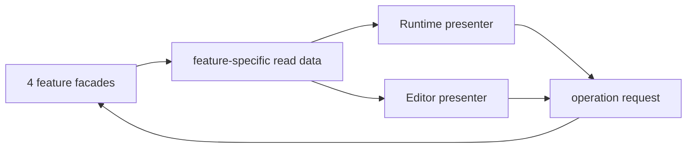

# Debug UIレイアウト・遷移仕様

対象はRuntime UIとEditorWindow。

## 文字配置

部品ごとの水平／垂直揃え、項目名・値・補助文の上下関係、行高変更時の中央配置は[Debug UI文字配置仕様](debug-ui-text-layout.md)に従う。単一行操作部品は縦中央、複数行の文章領域は左上を原則とする。renderer既定styleに配置を委ねない。

## 構成

DebugCommand、DebugSetting、DebugInspector、DebugDisplayを、実機アプリケーションとUnity Editorから利用する画面構成として提供する。

Runtime UIとEditor UIは同じ機能別read APIとoperation requestを使用するが、画面構成は共有しない。

## UI実装構成

RuntimeはIMGUI／uGUI／UI Toolkit、EditorWindowはIMGUIを使用する。4機能のread結果、UI state、操作requestへrenderer固有型を含めない。

RuntimeとEditorで共有するのは、各機能が返す値snapshot、操作request、入力editorの型対応表に加え、IMGUIのfield editor、validation表示、状態表示などの描画primitiveとする。window lifecycle、画面遷移、panel構成、Unity Selection連携は共有しない。

Ref、enum、Hierarchyなどの選択はdropdownへ集約せず、一覧画面またはpanel遷移として提供する。

uGUI版とUI Toolkit版は同じ機能別read APIとoperation requestを使用する別rendererとする。IMGUI rendererを経由せず、IMGUIの描画primitiveを再利用しない。

### 行モデル

Runtime UIの各ページは、renderer非依存の行の並び（internal `DexcUIRow`）として1か所で組み立てる。行の種類は見出し、ラベル、ボタン、入力、選択、スライダーの6つ。各行は次を持つ。

- 表示する値とエラーの読み出し、変更・確定・押下の処理
- 警告／エラーの調子、gamepadで巡る順番、一覧の項目かどうか
- 選択値をその場で前後へ送る処理（Cycle）、項目名の下に出す小さな札（Note。`Immediate`、`Read only`など）
- 一覧の項目の2行目（Detail）、右端の件数や結果（Trailing）、名前の前の印（Leading。お気に入りの★など）、一段下の階層を開くかどうか（Drill。右端に›を描く）

IMGUI／uGUI／UI Toolkitは同じ行を受け取り、見た目と入力の受け方だけを持つ。ページの中身、確定の意味、検証、gamepadの順番をrendererごとに持たない。

行の組み立ては各機能のform（Setting、Inspector、Command、Panel、詳細選択）と、formを持たないHomeとInspector入口に置く。例外は利用者定義の入力editorで、IMGUIのときだけ行の中で直接描く。



### UIが読み取るdata

UIは表示中の画面に応じて次のdataを各機能から読み取る。

- Registry収集世代とsession ID
- 機能ごとの`DebugCollectionSummary`と除外定義数
- 表示中範囲の一覧
- 選択中項目のdescriptorと生存状態
- draft、field validation、未反映状態
- running requestとcancel可否
- resultと機能別history／diagnostic page
- Inspector Watchの現在値
- DebugDisplayの完了frame番号

UIへ`Type`、`FieldInfo`、`PropertyInfo`、例外object、Unity objectの強参照を渡さない。表示とrequestにはdescriptor ID、instance handle、field IDを使用する。

### 収集状態とdiagnostic表示

`Ready`ではCollection Errorが存在しても正常descriptorの一覧と操作を表示する。Homeと該当機能tabへ除外定義数のbadgeを表示し、既知のCategoryまたはPathへ関連付けられる場合はその階層にもerror badgeを表示する。有効一覧へ不完全な仮descriptorは追加しない。

Runtime UIは既定で`3 definitions unavailable`のような件数と短いmessageを表示し、Diagnostic画面から詳細へ遷移する。Editor UIは型名、member名、Phase、Codeを一覧に含め、Diagnostic IDから例外詳細とstack traceを開ける。

`Unavailable`では該当機能tabだけを操作不能にし、他機能を利用可能なまま維持する。`Disabled`はErrorとして扱わず、compile symbolにより機能が無効であることを表示する。除外済みと判明しているPathへの操作結果は`definition-unavailable`として関連Diagnosticを表示し、未知またはstrippingで消失したPathの`not-found`と区別する。

Collection diagnosticは世代中保持され、operation diagnosticのring bufferとは別に表示する。旧世代のDiagnostic IDは`Stale`として表示し、現在の別diagnosticへ自動的に結び直さない。

### UI state

UI自身が所有するstateは画面上の操作状態に限定する。

- 現在のNavigationと遷移stack
- 検索文字列、展開node、scroll位置
- 選択中descriptor／instance／fieldのID
- Editor panel幅とlock状態
- 入力focusと確認dialog

Command draft、現在値、running、result、Watch、履歴は各機能のinternal storeが所有する。SettingのSubmit形式で未反映の編集値はUI stateが所有する。UIを閉じて再度開いた場合、session状態は再取得できるがSetting編集値は復元しない。Command draftを破棄する操作だけは明示requestにする。

### 更新方式

- Runtime UIは表示中画面に必要な範囲だけを一定周期で取得する。
- Editor UIは操作完了、Unity Selection変更、Editor updateを契機に表示中範囲を取得する。
- 各要求は表示中Category、page、展開node、選択対象など必要範囲だけを指定する。
- read結果は要求時点の範囲を完全に表し、UIはその範囲のcacheを置き換える。公開deltaは使用しない。
- 再初期化を検出した場合は、関連cache、選択、page位置を破棄して再取得する。
- operation完了後は該当範囲を再取得し、楽観的な値を確定状態として残さない。
- stale handleを受けた場合は詳細画面を閉じ、一覧を更新して失効理由を表示する。
- DebugDisplay描画は通常のfeature readを経由せず、rendererがDisplay Registryの完了frameを直接読む。

Scene Hierarchyは展開nodeのdirect children、Inspectorは選択中Source／instance／Component、HistoryとDiagnosticは有限pageをread単位とする。Watchは表示中一覧の現在値をまとめて置換する。汎用delta、append event、削除tombstoneをUI公開契約に含めない。

対象失効時は対象詳細を閉じ、同名objectへ自動的に選択を移さない。再初期化時はnavigationをHomeへ戻し、全session cacheを破棄する。

Runtime UIとEditor UIはUnity状態へ触れるreadをmain threadから同期的に呼び、表示範囲をpage、Category、展開nodeへ制限する。Scene検索だけはmain thread上でframe分割し、機能固有の検索状態をpollする。

### Runtime入力との境界

IMGUIによる描画と、UIを開く入力、navigation、submit／cancel、game input抑止を分離する。Runtime UIはproject固有のInput Actionやgameplay inputを直接所有しない。

- pointer（mouse、touch）とtext入力は各rendererのUI eventから受け取る。IMGUIはIMGUI event、uGUIはEventSystem、UI Toolkitはpanel eventを使う。providerを設定しなくても、tapまたはclickでmenuを操作できる。IMGUIとUI Toolkitはkeyboardによるnavigation、submit、backも各UI eventから受け取る。
- uGUI rendererは、menuを開いている間にsceneにEventSystemが無い場合だけ、pointer専用のEventSystemを作る。このEventSystemはmove／submit／cancelを処理しない。sceneが別のEventSystemを持った時、またはmenuを閉じた時に破棄する。
- ゲーム側からRuntime Debug Menuを開閉できる`DebugMenu.Open()`、`DebugMenu.Close()`、`DebugMenu.Toggle()`と、開閉状態を読む`DebugMenu.IsOpen`を公開する。`IsOpen`はDexcが無効なbuildでは常にfalseを返す。
- 3関数は`ConditionalAttribute("DEXC_DEBUGGER")`を持ち、Disabled状態ではRuntime UIを初期化しない。
- `DebugMenu`が開閉するのはRuntime Debug Menuの操作画面だけであり、DebugDisplayのHUD／Overlay／World表示には影響しない。
- gamepadとproject固有入力のnavigation、submit、cancelは差し替え可能な`DebugMenuInputProvider`から受け取る。
- 新Input SystemとLegacy Input ManagerのどちらにもRuntime UI本体は必須依存しない。入力backendごとの標準providerは設けない。
- 組み込みproviderは`Dexc.DebugUI`の`DebugGamepadInputProvider`だけとする。新Input Systemの`Gamepad.current`をReflectionで読み、d-padをnavigation、South／Startをsubmit、Eastをcancelとする。Input System packageまたはgamepadが無い場合は空のframeを返す。登録は他のproviderと同じく`SetInputProvider`で行う。
- project側providerは既存Action Mapを利用でき、UI表示中のgameplay input抑止と終了後の復帰をproject側規則に合わせられる。

`DebugMenuInputProvider`はfield値を編集する`DebugInputEditor`とは別の境界である。前者はRuntime Debug Menu全体のnavigationとgameplay input連携、後者はCommand fieldの値編集を担当する。

#### 公開provider契約

provider一覧、key、priority、auto selectionは公開しない。登録と選択を`SetInputProvider`へ統合し、Runtime UI全体でactive providerを最大1件だけ保持する。

```csharp
public static class DebugMenu
{
	[Conditional("DEXC_DEBUGGER")]
	public static void SetInputProvider(DebugMenuInputProvider provider);

	[Conditional("DEXC_DEBUGGER")]
	public static void ClearInputProvider(DebugMenuInputProvider provider);
}

public abstract class DebugMenuInputProvider
{
	public abstract DebugMenuInputFrame ReadInput();

	public virtual void OnInputStateChanged(DebugMenuInputState state)
	{
	}
}

public readonly struct DebugMenuInputFrame
{
	public DebugMenuInputFrame(
		Vector2 navigation,
		bool submitPressed,
		bool cancelPressed)
	{
		Navigation = navigation;
		SubmitPressed = submitPressed;
		CancelPressed = cancelPressed;
	}

	public Vector2 Navigation { get; }
	public bool SubmitPressed { get; }
	public bool CancelPressed { get; }
}

public enum DebugMenuInputState
{
	Closed,
	Navigation,
	TextInput,
}
```

両設定関数を`void`かつ`ConditionalAttribute("DEXC_DEBUGGER")`の対象とし、Disabled状態ではproviderの生成を含む引数評価を除去する。Enabled状態で`provider`が`null`の場合は`ArgumentNullException`とする。

- provider登録はsession状態である。`SetInputProvider`はUnity main threadから呼ぶ。sessionが無いときの`SetInputProvider`と`ClearInputProvider`は何もしない。
- provider未設定時も各rendererのUI eventによるpointerとtext入力は利用できる。gamepadとproject固有入力だけを利用不能とし、定義Errorにはしない。
- 最初の`SetInputProvider`は、そのinstanceを登録と同時にactiveにする。同一instanceの再設定は冪等であり、状態通知を重複させない。
- 別instanceがactiveの間に`SetInputProvider`された場合は要求を拒否する。現在のproviderを置換せず、両providerの型を含む競合diagnosticをsessionへ1件記録する。
- providerを切り替える場合は、現在のinstanceを`ClearInputProvider`してから新しいinstanceを設定する。
- `ClearInputProvider`は参照一致するactive providerだけを解除する。provider未登録時または異なるinstanceによる解除要求は冪等なno-opとし、active providerを変更しない。
- menuが開いている間にproviderを設定した場合は、設定直後に現在の`Navigation`または`TextInput`を1回通知する。
- `DebugMenu.InputProvider`は現在のactive providerを返し、未設定時は`null`を返す。provider一覧と選択UIは提供しない。providerの競合とcallback失敗はDiagnostic画面から確認する。

#### 入力frame

`Dexc.DebugUI`はactive providerの`ReadInput`をUnity main threadから1 Unity frameにつき最大1回だけ呼び、同じframe中の複数`OnGUI` eventでは取得結果を再利用する。

- `Navigation`は連続値の2D方向入力である。providerはproject入力をこの値へ変換し、`Dexc.DebugUI`がdead zone、初回delay、repeat間隔を一元管理する。
- `SubmitPressed`と`CancelPressed`は押したframeだけ`true`になるedge入力である。長押しrepeatをprovider側で生成しない。
- `SubmitPressed`と`CancelPressed`が同時に`true`の場合はCancelを優先し、Submitを処理しない。
- menuを開閉する入力、pointer、touch、keyboard、IME textは`DebugMenuInputFrame`へ含めない。projectは必要なshortcutから`DebugMenu.Open()`または`DebugMenu.Toggle()`を呼ぶ。
- providerが例外を送出した場合はそのframeを入力なしとして扱い、例外を公開UI loopへ伝播させず、同一原因を集約したdiagnosticを記録する。

#### UI状態とgameplay input

`Dexc.DebugUI`はproviderへInput SystemやLegacy Input Managerの具体的な操作を要求せず、次の抽象状態だけをmain threadから通知する。

| 状態 | 通知条件 | provider側の想定処理 |
| --- | --- | --- |
| `Closed` | menu閉鎖、provider解除、session再初期化 | gameplay inputとfocusをproject規則に従って復帰する |
| `Navigation` | menuが開き、text editorにfocusがない | UI navigationを有効にし、必要なgameplay inputを抑止する |
| `TextInput` | Runtime text editorがIMEを含むtext focusを得た | gameplay shortcutとtext競合入力を抑止する |

- 状態が変化した場合だけ`OnInputStateChanged`を呼ぶ。providerは同じ状態の再通知にも耐える冪等な実装としてよい。
- `DebugMenu.Close()`はactive providerを保持したまま`Closed`を通知する。次回Open時は同じproviderへ`Navigation`を通知する。
- `ClearInputProvider`は旧providerへ`Closed`を通知してからactive登録を解除する。
- `DexcDebugger.Initialize`によるsession再初期化では、menu、text focus、navigation repeatを破棄し、旧providerへ`Closed`を通知して登録も解除する。同じproviderを継続利用する場合も、新sessionへ明示的に再設定する。
- 状態callbackの例外はUI loopへ伝播させずdiagnosticへ変換する。解除と再初期化では、以前のcallbackが失敗していても`Closed`通知を再試行し、再試行の成否にかかわらずactive登録を解除する。
- 実際のAction Map、PlayerInput、Legacy axis、gameplay focusの停止と復帰はproviderが所有する。`Dexc.DebugUI`は各rendererのUI eventの消費とpointer専用EventSystemの生成を超えてproject gameplay inputを直接変更しない。

`DebugGamepadInputProvider`とproject固有providerは同じ公開契約を実装する。providerは入力APIから`DebugMenuInputFrame`への変換だけを提供し、auto registration、active providerの置換、menu UIの直接操作を行わない。

#### ページ内のnavigation

- 縦方向は行またはfooter操作のfocusを移す。IMGUIのCommand／Setting／Inspector field詳細では、field行を上から巡り、続いてfooter操作へ進む。
- 横方向は、focus中の行がCycleを持つ場合（enumとbool）にその値を前後へ送る。参照や候補を探す選択はCycleを持たず、選択画面を開く。
- 横並び表示（[Runtime UI Skinとasset包含](#runtime-ui-skinとasset包含)の`Layout`）では、一覧で右を押すとfocus中の項目を開き、一覧から開いたページで左を押すと一覧へ戻る。一覧列はpointer専用とする。
- 横並び表示ではセクション列がHomeの代わりになる。セクションの最上位のページ（Command／Settingの一覧の最上位、Inspector、History、Diagnostics、Panels）でCancelまたは左を押すと、focusはセクション列の今のセクションへ移る。セクション列では上下でセクションを選び、右またはSubmitで開き、CancelでmenuをHomeと同じく閉じる。セクション列にfocusがある間、ページ側の行と操作はfocus表示を持たない。

#### OS IMEのサポート範囲

- 通常の操作は、文字入力を確定またはキャンセルしてからmenuのBack／Closeへ進む。入力中の強制遷移、再初期化、再起動時にOS IMEまで自動終了させることは保証しない。
- 手動で閉じられるOS IMEの残留は既知の制約とする。
- 公開Close／Toggle、draft破棄、UI状態通知、gameplay inputの復帰契約は維持する。OS IMEの自動非表示と、Dexc自身の論理focus／入力状態を区別する。

## 入力editor

同じfield descriptorからRuntime用とEditor用のeditorを選ぶ。

| descriptor | Runtime | Editor |
| --- | --- | --- |
| bool | switch。押すか左右で反転 | toggle |
| enum | ‹ ›と左右でその場で前後。値を押すと1列の選択画面 | dropdown |
| number | numeric text。Slider指定時のみslider併用 | numeric field。Slider指定時のみslider併用 |
| string | full-screenまたはmodal text入力 | text field |
| serializable composite | fieldを縦方向に展開 | foldout |
| `InputRef<T>` | Source Pathの階層選択画面 | 階層または候補表、必要ならUnity Selection |
| `CommandLabel` | 評価済みtext | 評価済みtext |
| `CommandHeader` | section見出し | section見出し |

Rangeはvalidation、Sliderは操作方法であり、別metadataとして扱う。Rangeだけが指定された数値を自動的にsliderへしない。

入力editorを閉じたenumでSchemaへ埋め込まない。field属性から変換された`DebugInputEditorMetadata`、Input具象型、SemanticType、DebugValueKindをcontextとして、UI側Registryが対応可能なproviderを収集する。利用者定義metadataとeditor providerを登録できる公開拡張境界を設け、RuntimeとEditorはそれぞれのrendererに対応するproviderを選ぶ。

選択はPriorityだけで比較する。利用者providerは`uint` Priority、組み込みproviderは内部の負Priorityを持つ。最大値の競合は定義Errorとし、登録順へfallbackしない。選択結果はdescriptorとrendererの組合せごとにcacheする。Editor専用ColorFieldなどは`Dexc.Editor`側providerとして登録し、Runtime providerと独立して選択する。

providerは共通の`DebugInputEditor`を継承し、`CanEdit(DebugInputEditorDescriptor)`と`OnGUI(DebugInputEditorContext, DebugInputEdit)`を実装する。contextは現在値、既定値、前回実行値、validation issue、ReadOnly状態などの不変viewだけを提供し、Command instance、`IDebugInput`、Registry、対象Unity Object、生のReflection memberを公開しない。

変更は`DebugInputEdit.SetValue(DebugValue)`へ候補として返す。rendererは描画後に検証し、成功した値だけをUI draftへ反映する。providerはInputやゲーム状態を直接変更しない。focusや入力途中のtextなどの可変UI状態は、再利用されるprovider instanceではなくrendererがfieldのUI用IDごとに保持する。詳細な値モデルと失敗時の扱いは[Input値モデル](debug-input-value-model.md#editor-providerの公開境界)を正本とする。

明示metadataに対応するeditorがない場合は次の候補へfallbackする。ただしInputRefは自由なString editorへfallbackせず、Reference editorがなければ読み取り専用または入力不可とする。

各editorは編集値、validation error、既定値との差、前回値との差を表示できる。IMEを含むtext入力開始時にgame inputを抑止し、submitまたはcancel後にfocusを戻す。

## 操作状態

共通する操作状態を次に固定する。

| 状態 | UI |
| --- | --- |
| Loading | 一覧を保持したまま更新indicatorを表示 |
| Ready | 入力と主操作を有効化 |
| Invalid | field単位errorを表示し、Execute／Applyを無効化 |
| Running | progress、経過時間、可能ならCancelを表示 |
| Succeeded | 結果と完了時刻を表示 |
| Failed | 公開errorとHistoryへの導線を表示 |
| Stale | 対象消失または再収集を説明し、一覧へ戻す |

Failedの詳細ではDiagnostic IDがある場合だけ例外詳細を表示する。stack traceは保持しているものをそのまま表示する。

`ReadOnly` Commandは`Lock`実行中、`Lock` CommandはほかのCommandが1件でも実行中なら、待機順を表示せず`Unavailable / command-locked`としてExecuteを無効化する。競合後にDispatchされたrequestも同じ理由で拒否し、自動再試行しない。

危険操作の確認はCommand descriptorが要求する場合だけ表示する。すべてのCommandへ一律に二重確認を課さない。

## 共通する機能入口

| 入口 | 主操作 |
| --- | --- |
| Command | 処理選択、対象1件の選択、Input、実行、結果 |
| Setting | クラス内の複数値、編集、Apply、初期値を含むPreset |
| Inspector | Registered／Scene、対象、Component、Field、Watch |
| History | Command実行、Setting変更、Inspector書き込みの確認 |

DebugDisplayは表示UIを持つが、独立した操作画面を持たない。Displayの表示ON／OFFはSettingから行い、表示結果はHUD、overlay、Playerのcamera出力へ直接描画する。Runtime Debug Menuを閉じても、提供中または寿命が残るDisplayは描画を継続する。

## Runtime UI

### 制約

- 小さい画面、safe area、可変解像度へ対応する。
- touch、gamepad、keyboardのいずれでも一方向に辿れる画面遷移にする。
- hover、右click、drag前提の操作を置かない。
- Debug UIを開いてもゲームが進行し続ける場合がある。
- text入力中はゲーム操作を抑止し、閉じた時に入力focusをゲームへ戻す。
- Hierarchyや候補一覧を全件描画せず、遅延展開と件数上限を使用する。
- Display overlayをDebug UI自身が隠さないよう、表示領域を退避または一時的に薄くする。

### Runtime UI Skinとasset包含

Runtime UIの調整parameter用に別のSettings assetを追加せず、既存`DexcDebuggerOptions`をcode側設定とする。見た目、platform profile、Unity asset参照だけをpublic `DexcRuntimeUISkin : ScriptableObject`へ一本化し、`DexcDebuggerOptions.RuntimeUI.Skin`から明示的に指定する。

Skinは次の責務を持つ。

- Windows Player、Android Portrait、Android Landscapeの3 profileごとに、panel目標寸法、safe-area margin、alignment、表示row高、最小hit領域を保持する。既定値は本書のResponsive Renderer目標と一致する
- 同じprofileに、広い画面での並べ方`Layout`（`DexcRuntimeUILayoutMode`の`Single`／`Auto`／`Split`）と横並び時のpanel寸法`SplitPanelSize`を保持する。`Layout`の既定は`Single`で、この設定より前に保存されたassetも`Single`として読む。`SplitPanelSize`が0のときは`960 x 560`を使う。詳細は[広い画面での横並び](#広い画面での横並び)に従う
- renderer間で意味を共有するsemantic palette、opacity、font、Sprite／Texture／Material参照を保持する。IMGUI／uGUI／UI Toolkit固有のobject hierarchy、UXML、navigation stateは保持しない。UI Toolkitのpanel infrastructureに必要なinternal `PanelSettings` template参照だけは、後述の限定例外として保持する
- Player DebugDisplayのWorld Visual Shaderを直接参照する。Shaderはruntime `Resources`、Preloaded Assets、Graphics SettingsのAlways Included Shadersへ置かない
- `Assets > Create > Dexc > Runtime UI Skin`から、既定のprofile値、package内のResources外World Visual Shader、UI Toolkit用package `PanelSettings` templateを設定したassetを作成できる。packageによるproject assetの自動作成、自動検索、自動初期化は行わない
- 1つのSkin asset内に3 profileを持ち、profile別Settings assetまたは`DexcRuntimeUISettings`を追加しない。複数themeのruntime切替は扱わない

`DexcRuntimeUISkin`は`Dexc.Runtime`に置くrenderer-neutralな公開asset契約とし、uGUI／UI Toolkitの任意package型を公開fieldへ含めない。Unity 6.3.20f1のruntime `PanelSettings`がThemeを要求するため、Skin内部の非公開serialized `UnityEngine.Object`参照からResources外package `PanelSettings` templateをsnapshotし、UI Toolkit rendererだけが型検証して使用する限定例外とする。public getter／field、第二Settings／Holder、scene／prefab setupは追加しない。各rendererはInitialize時に検証・snapshot化された同じSkin値を解釈する。session中にassetを変更しても現在sessionへ暗黙反映せず、再度`DexcDebugger.Initialize`した時点で新しいsnapshotを使用する。

package `PanelSettings` templateはResources外のpackage `ThemeStyleSheet`を直接参照する。Themeは標準Button／TextField等の基盤styleを成立させるinfrastructure assetに限定し、利用者が選択するvisual Theme、semantic palette、platform別Settingsにはしない。この1件のTSS内だけで`unity-theme://default`をimportしてよい。rendererはtemplateをsession用にcloneし、package asset自体を変更しない。runtimeで`ScriptableObject.CreateInstance<PanelSettings>()`を呼んで`Assets/UI Toolkit/UnityThemes`を生成する経路、`Resources.Load`、`AssetDatabase`、Unity internal reflectionを使用しない。

Skinの色はPanel、Header／Footer、Row、Accent、Errorに加え、Primary Text、Secondary Text、Selection、Focus、Success、Warning、Disabledの意味スロットを持つ。これは任意色配列ではなく、rendererをまたいで状態の意味を固定するnamed fieldとする。利用者が選択する別visual Theme asset、profile別Settings、renderer固有style objectは追加せず、同じ1つの`DexcRuntimeUISkin`へ集約する。UI Toolkit基盤TSSはsemantic paletteを所有せず、Theme切替には数えない。値の無いassetには既定値を補い、全Color成分をInitialize時にfinite検証してsession snapshotへcopyする。

`DexcRuntimeUISkin.Font`は任意fieldとし、packageはCJK FontまたはTextCore FontAssetを必須依存として同梱せず、未設定を初期化Errorにしない。Font未設定時は各rendererがUnity標準font／fallbackを使用するbest-effort modeとする。このmodeは未検証platform／Unity version／端末までglyphを保証する公開契約にはしない。利用者が明示Fontを設定した場合は同じ`UnityEngine.Font`を3 rendererへ適用する。UI Toolkit専用TextCore field、必須Font asset、第二Skin／Settingsは追加しない。

FontとそのFontを設定したSkin presetを、利用者が明示操作した場合だけimportされる任意の`.unitypackage`として配布してよい。このpresetは通常import、`DexcDebugger.Initialize`、Enabled buildの必須条件にせず、main packageから自動展開・自動参照しない。

各rendererはsemantic paletteを内部styleへ変換する。keyboard／gamepad focus、selected／current value、pressed、disabled、Error／Warningは別状態とし、focusは色だけでなく輪郭、marker、太さ等の非色cueを併用する。IMGUIはsnapshot世代ごとにTexture／`GUIStyle`を生成・cacheし、`OnGUI`中にstyle／Textureを毎frame生成しない。これらのrenderer固有表現は公開契約にせず、`RuntimeUI.Skin == null`のcode-only baseline、layout、入力意味を維持する。

`RuntimeUI.Skin == null`は許可し、引数なし`DexcDebugger.Initialize()`を維持する。この場合、既定IMGUI Runtime UI shellはTexture／専用Shaderを要求しないcode-only baselineで表示する。World VisualなどSkin必須の描画は行わず、欠落をsession diagnosticへ1件だけ記録する。UI Toolkit rendererを選択した場合だけ、Skinと有効な`PanelSettings` template（themeStyleSheetを持つもの）を必須とし、欠落時はdiagnostic（`runtime-uitoolkit-panel-settings-missing`または`runtime-uitoolkit-panel-settings-invalid`）を記録してIMGUIで描画する。IMGUI／uGUIと引数なしInitializeを失敗させない。Skinを指定した場合は、非有限値、負のmargin、0以下のpanel／row／hit寸法、負の`SplitPanelSize`、未定義alignment／`Layout`、必須Shader欠落を初期化時に検証し、不正なassetは`ArgumentException`として拒否する。profile目標が現在のsafe areaより大きいこと自体はErrorにせず、必ずsafe area内へ縮小する。

Skin assetと参照先はruntime `Resources`外に置く。利用projectはSkinを保持するserialized fieldと`Initialize`呼出しを`DEXC_DEBUGGER && !DISABLE_DEXC_DEBUGGER`でcompile条件化する。Enabled buildは指定Skinと依存asset（明示Font、Texture、Material、Shader、UI Toolkit `PanelSettings`／Theme）を含み、Disabled／Assembly Excluded buildはそれらを含まない。

### Responsive Renderer目標

IMGUI、uGUI、UI Toolkitの各rendererが共有する目標を次に示す。Android／Windowsを別UI architectureへ分割せず、同じRuntime UIの画面幅、向き、renderer差を揃える。

| Profile | 基準画面 | Panel配置 | Panel目標 | Row目標 |
| --- | ---: | --- | ---: | ---: |
| Mobile Portrait | `390 x 844` | safe area内の下寄せ | `320 x 520` | 全renderer `28` |
| Mobile Landscape | `844 x 390` | safe area内の左上 | `480 x 366` | 全renderer `28` |
| Windows Player | `1366 x 768` | 左寄せ、上下中央 | `360 x 520` | 全renderer `28` |

表はSkinの既定値で、Skin assetに指定した値があればその値を使う。全Profileの外周基準は`12 px`とする。基準画面より小さい場合はsafe area内へ縮小し、panelを画面外へ出さない。これらは公開layout API、全端末での固定pixel保証、renderer別の別機能契約ではない。

profileとscaleは次のとおり決める。

- Runtime Android Playerは画面向きによりAndroid Portrait／Android Landscape、Runtime Windows PlayerはWindowsを選ぶ。Unity Editor GameViewはActive Build TargetがAndroidなら画面向きによりAndroid Portrait／Android Landscape、それ以外ならWindowsを選ぶ。その他のPlayer platformはWindows fallbackとし、対応済みplatformとして保証しない
- 物理`Screen.width`だけをprofile判定に使わない。Unity Editor GameViewのLow Resolution切替はprofileを変更しない。Low Resolution対応の保証範囲はUnity Editorとし、Windows PlayerのOS DPI scalingや任意monitor densityまで同じ挙動を保証しない
- `DexcRuntimeUISkin.LayoutProfile`のPanel、Safe Area Margin、Row、Minimum Hitは上表の基準画面におけるlogical reference unitとして解釈する。各rendererはclipped Safe Areaとprofile基準画面の比からuniform reference scaleを求め、同じscaleでpanel、margin、row、hit領域を変換してSafe Area内へ配置する。IMGUI、uGUI、UI Toolkitでprofile選択、scale、logical layout結果を共有し、renderer固有の別閾値を持たない
- 基準画面ではpanel／row目標へ一致させる。Unity Editorの通常解像度とLow Resolutionでは、scaleで正規化したpanel、Header／Content／Footer、row／hit、入力座標が一致する
- 可変解像度／Safe Areaでは、platform／orientationに応じたprofile、Safe Area内包含、single shell、固定Header／Footer、bounded Content、横overflowなし、panel外clipなし、logical minimum hit、同じ操作結果を満たす
- 既存3 profile、基準画面、public fieldを使用し、density override、第二Settings、platform別追加Skin fieldを公開契約へ追加しない

- Mobile PortraitはゲームとDebugDisplayの退避領域を上側へ残し、単一panelを下寄せする。
- Mobile LandscapeはゲームとDebugDisplayの可視領域を右へ残し、単一panelを左上へ寄せる。
- Windows PlayerはAndroidと同じ単一panel push navigationを左寄せし、EditorWindowの3 pane layoutへ切り替えない。
- 全ProfileでHome→List→Detail／Draft→Result／Historyを1画面ずつ進み、Header、有限なContent viewport、必要時だけ表示するFooter actionを共通構造とする。
- Display（HUD・Overlay）の文字がpanelと重なる場合は、文字を画面の反対側（左右反転した位置）へ移す。反対側もpanelと重なる場合は元の位置のままとし、menuが前面に描く。menu openだけを理由にDisplayを停止しない。
- 上の単一panelは`Layout`が`Single`（既定）の場合の配置である。横並びを有効にした場合は次節に従う。

#### 広い画面での横並び

- Safe Areaが横長（幅が高さより大きい）で、marginを除いた幅が`SplitPanelSize.x`×scale以上ある場合だけ横並びにできる。このときheaderに`Single`／`Split`の切替を表示する。縦長の画面では幅が足りても横並びにしない。切替はmenuを開いている間のruntime上書きであり、Skinへ保存しない。
- `Layout`が`Auto`または`Split`で横並びにできる場合は横並びで開く。panelは`SplitPanelSize`（Safe Area内へ縮小）とし、配置はprofileのalignmentに従う。横並びにできない場合は`Layout`によらず単一panelとする。
- 横並びでは左端にHomeの6セクション列（幅216）をpanelの上端から下端まで置き、header、ページ、footerはその右に置く。起動メニューの表示中はセクション列を置かない。
- 横並びではHomeページを表示しない。menuを開いたとき（Homeへ移るとき）は、`DebugPanels.Home`に登録済みのPanelがあればそのPanel詳細を開き、なければ最後に開いたセクション（初回はCommand）を開く。最後に開いたセクションは`DebugStorage`の`UI/LastSection`へ保存し、次の起動でも使う。単一panelではHomeを開く。
- 横並びでは、セクションの最上位のページはheaderの戻るボタンを持たない（戻る先のHomeはセクション列が代わる）。
- 一覧から開いたページ（Command詳細、Setting詳細、Panel詳細）では、セクション列の隣に元の一覧の列（幅288、残り幅の半分まで）を置き、開いている項目を示す。一覧ページ自体は一覧の列を持たず、残り幅を使う。
- 一覧列はpointer専用とする。gamepadの操作は[ページ内のnavigation](#ページ内のnavigation)に従う。

Renderer差は表現と実装方式に限定する。IMGUIは共通の設定行高、矩形control、明示scroll stateを基準とし、animation、hover、dragを要求しない。uGUIはSafe Area root、Layout Group、`ScrollRect`、Selectable navigationを使用する。UI ToolkitはC#で生成する`VisualElement`のflex hierarchy、`ListView`／`TreeView`等のvirtualization、focus navigationを使用する。uGUIとUI ToolkitはIMGUI drawing primitiveを経由せず、同じfeature read API、UI state、operation requestへ直接接続する。

UI Toolkit rendererはruntime UXML／USSをproduction sourceにせず、code-generated hierarchy／styleへ統一する。単一SkinからResources外package `PanelSettings` template／基盤Themeへinternal direct referenceする。`UIDocument`とUI Toolkit controlは使用するが、Resources、Preloaded Assets、Always Included、`Assets/UI Toolkit`自動生成、scene／prefab上の第二asset holder、public `DexcRuntimeUISkin`のUI Toolkit固有fieldを追加しない。hierarchy生成、Skin snapshotからの内部style変換、state bindingを分離する。UI Builder編集可能性は要件にしない。

### Rendererの選択

```csharp
public static class DebugMenu
{
	public static DebugMenuRenderer Renderer { get; }
	public static bool SetRenderer(DebugMenuRenderer renderer);
	public static string RendererName(DebugMenuRenderer renderer);
}

public enum DebugMenuRenderer
{
	IMGUI,
	UGUI,
	UIToolkit,
}
```

- 起動時のrendererはScripting Define Symbolsで決める。`DEXC_RUNTIME_UITOOLKIT`があればUI Toolkit、無く`DEXC_RUNTIME_UGUI`と`DEXC_HAS_UGUI`の両方があればuGUI、それ以外はIMGUIとする。
- 選択したrendererだけを構築する。UI Toolkitを選択してSkinの`PanelSettings` templateが無いまたは不正な場合は、UI Toolkit rendererを構築せずdiagnosticを記録し、IMGUIで描画する。この間`Renderer`は`IMGUI`を返す。選択はUI Toolkitのまま保持し、有効なtemplateを持つSkinのsessionで改めて構築する。
- `SetRenderer`は実行中にrendererを切り替える。要求は保持し、UI driverの次のUpdateで適用する。`DEXC_HAS_UGUI`が無い状態で`UGUI`を要求した場合だけ`false`を返して何も保持しない。それ以外は`true`を返す。
- 適用時、menuが開いていれば閉じ、rendererを作り直し、active providerを再設定し、menuを開き直す。起動メニュー表示中、またはPanels画面を開いていた場合はPanels一覧へ戻し、Panel詳細を開いていた場合はそのPanelを開き直す。menuが開いていない状態で現在と同じrendererを要求した場合は、現在のsessionのSkinでrendererを作り直す。
- 適用後にrendererが有効にならなかった場合（UI Toolkitの`PanelSettings` template欠落など）はIMGUIへ戻し、`Renderer`は`IMGUI`を返す。
- `Renderer`は実際に描画しているrendererを返す。`RendererName`は`IMGUI`、`uGUI`、`UI Toolkit`の表示名を返す。
- `DEXC_DEBUGGER`が無い場合、`SetRenderer`は要求が`IMGUI`のときだけ`true`を返す。

### 起動とHome

packageはmenuを開く画面上のボタン、gesture、shortcutを持たない。projectが自身の入力またはUIから`DebugMenu.Open()`、`DebugMenu.Toggle()`、`DebugMenu.Close()`を呼んで開閉する。

HomeはCommand、Setting、Inspector、History、Diagnostics、Panelsの名前を主にした選択行をこの順に並べる。各行は右端に件数（Commandの定義数、Settingのグループ数、InspectorのWatch数、DiagnosticsのError数、Panel数。Historyは件数なし）と›を表示する。件数は最大1秒に1回だけ数え直す。CommandまたはSettingの収集に除外定義または収集errorがある場合は、その下に件数を示す警告行を1行表示し、押すとDiagnosticsを開く。

続けて、お気に入りがあれば`FAVORITES`見出しの下にお気に入りのCommandとSettingグループを、Command実行履歴があれば`RECENT`見出しの下に最新3件の実行を並べる。RECENTの行を開くと、履歴の「入力を開く」と同じく保存した入力を復元した入力画面へ移る。gamepadはこれらを上から順に巡る。重複説明、常設のLast error、実データのない状態表示は置かず、空の見出しも表示しない。Displayの切替はSettingから行う。

未初期化時はHomeに初期化案内の1行だけを表示し、機能readを呼ばず操作を無効にする。未初期化を定義0件と混同しない。

起動メニューをRuntime Debug Menuで表示している間の画面と操作は[起動メニュー仕様](debug-boot.md)に従う。

### 共通フォーム

[文字配置仕様](debug-ui-text-layout.md)を適用し、Runtime IMGUI／uGUI／UI ToolkitとEditorで同じ入力順・意味・配置規則を使う。

- Runtimeは項目名を左、値を右に同じ行へ置く。項目名の列は行幅の40%で、2行まで折り返す。3行以上になる場合、または行幅が280未満の場合は、項目名を値の直上へ置いて全文折り返す（判定は全rendererで共有）。行幅は入力の行の帯の内側の幅で、全rendererで同じ式（panelの幅からscrollbar、一覧の左右の余白、帯の左右の余白を除いた幅）とする。項目名は単語の切れ目（空白、`_`・`-`・`/`・`.`の後、`SourcePath`の`P`のような大文字の前）で折り返し、単語の途中で1〜2文字だけ次の行へ残さない。列より長い単語はrendererの折返しに任せる。値は2行の項目名の縦中央に置く。Editorは項目名を入力の直上に全文折返しで置く。型名やPathの重複表示を除く。対象の選択値が長い場合だけ一行省略し、候補一覧から全文を読めるようにする。
- `Immediate`、`Read only`などの注記は項目名に連結せず、項目名の下に小さな札として表示する。
- 一行入力・readonly値は左／縦中央、操作ボタンは水平／縦中央、複数行本文は左上。Vector／Colorの成分はX／Y／Z／W、R／G／B／Aを左に置いて縦に並べる。
- 行高は既存Skinの`max(RowHeight, MinimumHitHeight)`を全rendererで共有。新規既定値は両方28。既存Skinの明示値は上書きせず、新しい公開設定を追加しない。行間4、項目名と値の列間6（項目名を上に置く場合はラベル下5）、成分列36、「…」列28（「…」を持つ行だけ）。fontに必要な内側余白を下回る場合は必要高を確保する。
- 入力・選択・スライダーの行は、panelより一段明るい帯（Header色）の上に置き、帯の内側に左8・右6・上下4の余白を取る。入力欄は帯より明るいRow色とする。Vector／Colorの成分の行は1つの帯を共有し、成分の間に行間を入れない。選択中の行は帯全体を選択色で塗り、2pxの輪郭を付ける。入力欄は選択中も自分の色を保つ。一覧の行も選択中は塗りと輪郭で示し、左端の印は使わない。
- Runtimeの全rendererで、入力の行は入力欄を赤枠にし、エラー文を値の下へ書く。行はエラー文の分だけ伸び、値の幅・位置は変えない。選択肢の行は枠を付けずエラー文だけを書く。ラベル行のエラーは「!」のままとし、押すと全文を開く。値は帯の右端まで伸ばし、「…」は持つ行だけ値の右端に置く。EditorはRuntimeと別で、全行で末尾エラー枠を予約する。スクロールバー領域も常に確保し、スクロールの有無で入力の幅・位置を変えない。
- 「!」は対象の詳細、footerの件数操作は全エラーを開く。本文は最大296×260かつpanel内に収まる有界領域。詳細から対象入力へ移動できる。閉じると元のfocusとscrollへ戻す。背景への操作を遮断する。
- 確認・選択・エラー詳細・全文編集は同じpanel内の別ページを共通のフォールバックとして使える。型やPathから存在しない説明・単位を生成しない。
- 長い数値・文字列は一行内スクロールまたは「…」から全文編集。raw textと整数精度を保持し、値の長さで通常行をTextAreaへ切り替えない。明示的な複数行欄は左上揃えの有界TextAreaとする。
- Runtimeで編集できない入力の値は、入力欄の枠を描かず文字として表示する。Inspectorの配列の中身を開いたページは、要約の行に続けて1要素1行で並べ、番号を右揃えの列にして1行おきに帯を敷く。
- 真偽値はRuntimeではswitch、Editorではtoggle、配列とobjectは読み取り専用の値として表示する。Runtimeのenumの選択は値の両側の‹ ›で、enumと真偽値はgamepadの左右で、その場で前後へ送る。参照や候補を探す選択は値の右端に›を表示し、選択ページを開く。入力を持たない見出しは全rendererで表示する。Panelの部品はSettingと同じ入力・選択・スライダーを使う。
- 一覧の検索は入力中に絞り込まず、Enterまたはfocusが外れたときに適用する。Command／Settingの一覧では検索欄をgamepadで巡る最初の項目とし、一覧を開いたときは検索欄を選ぶ。決定で入力を始める。
- 一覧の行は名前を主にし、補助情報を2行目、件数や結果を右端に置く。下の階層を開く行は右端に›を付ける。Historyの行は2行目に時刻と種類、Diagnosticsの行は1行目にseverityとCode、messageと対象を2行目以降に表示する。Diagnosticsの行は右端に何も置かず、2行目以降も行幅いっぱいを使う。2行目以降の長い名前（型の完全名など）も項目名と同じく単語の切れ目で折り返す。右端の件数や結果は1行目の高さに置く。
- RuntimeのHeaderは左から戻るボタン、menu内の位置（小さい文字）とその下のページ名（太字）、Command詳細の`History`（そのCommandの過去の入力を選び直す）、Command詳細とSetting詳細のお気に入り★、閉じるボタンを並べる。Command詳細のfooterは`Execute`だけとし、gamepadは`Execute`の次に`History`を巡る。★はgamepadで巡る順番の最後（footerと閉じるボタンの後）に置く。位置とページ名はそれぞれ1行に収め、収まらない分は右端で切る。ボタン（戻る、`Single`／`Split`、★、閉じる）はどれも行の高さとし、幅を保って長いページ名に押し出されない。`Single`／`Split`は選ばれている方を選択色で塗り、輪郭は付けない（輪郭はgamepadのfocusに使う）。Command Path、Settingグループ、InspectorのComponent、Panel名、詳細ページの題はheaderへ表示し、本文の先頭に題の行を置かない。
- RuntimeのFooterは補助操作を左に固定幅で、主操作を残りの幅で置く。focusは輪郭と背景で示し、「▶」などの文字の印を付けない。使えない操作は輪郭のないDisabled色の塗りで示す。
- Header／Footerと本文を分離し、本文だけ縦スクロールする。幅不足のfooterは同じ行高の二段表示へ切り替える。低高さでも入力行を縮小せず本文へ到達できる構造にする。可変高ラベルを含む可視領域の制限と有限queryを維持する。

panel目標はWindows 360×520、Portrait 320×520。Landscapeはsafe area内の左上に置く。Skinに指定した寸法はそのまま使う。フォールバックは、Runtimeで項目名を値の上へ置く行幅280を除いて固定breakpointを持たず、必要幅・高さを実際の文字とcontrolから算出する。

### 遷移と未適用入力の寿命

| 操作 | 保持／破棄 |
| --- | --- |
| Commandの参照・確認・エラー・全文編集から戻る | 同じdraft・raw text・scrollを保持。確認取消ではrequestを破棄して編集へ戻る |
| Settingのエラー・Enum・全文編集から戻る | 同じクラス内の未適用入力を保持 |
| Setting詳細から一覧／Homeへ戻る、閉じる、別クラスを選ぶ | 未適用入力を破棄。適用済み値は戻さない。入力取消ボタンや破棄確認は置かない |
| Settingからプリセット選択へ移動 | 未適用入力を破棄し、選択と明示的な適用を別操作にする |
| Editorで同じ選択の一覧／詳細／下部タブを切替、狭幅／拡幅へ変更 | 選択・draft・raw text・scrollを保持。レイアウト切替を画面終了と扱わない |
| Editorで別Settingクラス／別機能へ移る、Windowを閉じる | 未適用Setting入力を破棄。Commandのdraft・実行寿命はCommand契約に従う |
| session終了・再初期化・対象失効 | 失効処理に従いID・draft・bindingを破棄。同名対象へ結び直さない |

RuntimeはHome→一覧→詳細のpush遷移を使う。Command draftの破棄は明示的なDraft操作で行い、バックエンドを暗黙再実行しない。実行中の取消要求と実処理の終端は区別する。

## Runtime Command

一覧はフォルダと検索を持つ。実行履歴はCommand詳細のheaderの`History`とHomeから開く。候補は名前を主にし、識別に必要なPathだけを補助表示する。

一覧はPathの`/`区切りから作るフォルダ単位で開く。最上位は先頭に`★ Favorites`（件数）、続けてフォルダ（含むCommand数）、その階層のCommandを並べる。Backは1つ上のフォルダへ戻り、最上位では一覧を離れる。検索中はフォルダを使わず、一致したCommandをフルPathで平坦に並べる。Homeから一覧を開くと最上位から始める。

Command詳細のheaderの★でお気に入りへ追加・解除する。お気に入りはCommand Pathで識別し、`DebugStorage`の`UI/Favorites/Command`へ1行1 Pathで保存する。読み込み時に見つからないPathは表示から除くだけで、保存値からは消さない。

詳細は説明、InputRefと通常入力を定義順に表示する。対象も他の入力と同じ項目名＋選択欄とし、未選択とMissingを区別する。先頭候補や同名objectを自動選択しない。InputRef変更後の関連field通知・validationは既存backendを使う。

Executeではimmutable requestを生成する。`ConfirmationMessage`がある場合だけ確認画面を挟み、未設定なら直接Dispatchする。確認はUIの操作であり、backendに承認待ち状態を追加しない。確認中のrequestと編集用draftを混同しない。

実行中も入力欄を残して無効化し、固定footerに実行状態・取消要求を表示する。取得できない進捗率は作らない。処理終了まで再実行を抑止する。完了後はフォームの末尾へstatus・duration・Outputまたは失敗詳細を表示する。CancelledはOutputを持たない。後からdraftを編集しても前回結果を変えず「変更前の結果」と区別する。

履歴詳細の「入力を開く」は保存snapshotから新しいdraftを作り、同じ入力画面へ移動する。閲覧・復元だけで実行しない。参照失効・削除field・型不一致は復元validationへ従い、履歴snapshotは変更しない。再実行は改めてExecuteし、必要な確認も通常通り通る。

## Runtime Setting

一覧は`SetId`ごとのクラス、詳細は同クラスの複数propertyを一つのスクロールフォームへまとめる。単項目だけを想定した詳細画面にしない。検索で一致したpropertyからクラスを開いた場合も、同クラスの他項目を編集できる。

一覧はCommandと同じく、グループ名の`/`区切りから作るフォルダ単位で開き、最上位の先頭に`★ Favorites`（件数）を置く。Back、検索中の平坦な表示、Homeから開いた時の位置もCommandと同じとする。Setting詳細のheaderの★でグループをお気に入りへ追加・解除し、グループ名を`DebugStorage`の`UI/Favorites/Setting`へ1行1件で保存する。

```text
‹ Setting                         ★ ×
  Gameplay
───────────────────────────────────
カスタム · 1 pending · 1 error
最大体力（長い     [100           ]
項目名は折返し）   値が範囲外です
時間倍率           [1.0           ]
IMMEDIATE
FPS表示                       [ ●]
難易度             [‹] Normal  [›]
風               X [0             ]
                 Y [0             ]
                 Z [2.5           ]
───────────────────────────────────
[プリセット] [変更を適用          ]
```

詳細の先頭行は値が一致するプリセット名に加え、Apply待ちの項目数（`N pending`）とエラーのある項目数（`N errors`）を表示する。図のエラー文はIMGUIの表示で、uGUI／UI Toolkitは行末の「!」から開く。

Submit項目はfooterの「変更を適用」で変更済み項目へ順にWriteする。Immediate項目は入力確定時に個別Writeし、他項目のdraftを保持する。現在値／初期値／Scopeの比較列、個別Reset、入力取消ボタンは設けない。readonlyは同じ行高で編集不可にする。

プリセット選択を適用操作の隣へ配置する。選択画面は「初期値」を含む名前一覧と適用操作のみとし、内容・差分・件数・説明の常設表示や別の確認画面を置かない。適用中の表示は実値との一致から決め、最後の選択名を適用済みとみなさない。実際の値・失敗の扱いは[Setting UI接続](debug-setting.md#ui接続)を正本とする。

## Runtime Inspector

### 入口

RegisteredとSceneを同じInspector内の別分類として表示する。

```text
┌──────────────────────────────┐
│ ‹ Inspector                  │
├──────────────────────────────┤
│ Registered                  ›│
│ Scene                       ›│
│ Watch                       ›│
└──────────────────────────────┘
```

### Registered

```text
┌──────────────────────────────┐
│ ‹ Enemy / Nearby             │
├──────────────────────────────┤
│ Goblin / Enemy_12 / 2.1m    ›│
│ Orc / Enemy_08 / 4.7m       ›│
│ Slime / Enemy_21 / 6.0m     ›│
└──────────────────────────────┘
```

手動RegisterまたはDebugInspectorSourceが提供したLabelを表示する。候補の再取得で消失した対象を一覧から除く。

### Scene

```text
┌──────────────────────────────┐
│ ‹ Scene     [Name / Type...] │
├──────────────────────────────┤
│ ▼ Stage03                    │
│   ▼ Enemies                  │
│     › Enemy_12               │
│     › Enemy_08               │
│   › Environment              │
│ › DontDestroyOnLoad          │
└──────────────────────────────┘
```

Hierarchyは開いたnodeだけ取得する。検索時はHierarchyの代わりにsceneとhierarchy path付き結果を表示する。

### Field

```text
┌──────────────────────────────┐
│ ‹ Inspector                × │
│   EnemyController            │
├──────────────────────────────┤
│ HP          [80          ] ! │
│ State       [‹] Chase    [›] │
│ Target      [Player / Main ›]│
│ Speed       [3.5           ] │
│ READ ONLY                    │
├──────────────────────────────┤
│ [Watch] [Apply             ] │
└──────────────────────────────┘
```

menu内の位置（Inspector）の下に開いているComponent名を表示する。図の「!」はuGUI／UI Toolkitの表示。enumは‹ ›でその場で前後し、boolはswitchで反転する。参照（Target）は›から選択ページを開く。

Componentごとに複数fieldを共通フォームで縦に表示する。登録fieldを優先し、Sceneから開いた未登録fieldは読み取り専用、編集modeは明示操作で有効化する。Runtimeでは編集modeを有効にするまで、field一覧の上に未登録fieldが読み取り専用である旨と「Enable editing…」を帯として置く。観測値の更新で未適用入力を上書きしない。Watchは対象・field単位に追加し、選択が変わっても更新する。失効はMissingで示し、別対象へ置き換えない。

## Runtime DebugDisplay

DebugDisplayは次の3層へ描画する。

1. HUD: FPS、connection、global state
2. Overlay: text、value、event
3. World: path、range、bounds、relation

```text
┌ FPS 59.8 ─ Frame 16.7 ms ┐
│                           │
│       Enemy_12 ───▶Player │
│          (range)          │
│                           │
└───────────────────────────┘
```

WorldはPlayer cameraの通常描画として表示し、Gizmos／HandlesやEditor-only callbackを使用しない。表示をtouch対象にしない。ON／OFFはSetting画面から行う。DebugDisplaySubjectのLabelはWorld表示の補助textとして利用できる。

## Editor UI

### 特性

- dock可能なEditorWindowとして提供する。
- 広い画面を使い、一覧、詳細、履歴を同時表示する。
- keyboard検索、複数選択、copyを利用できる。
- Unity HierarchyとScene viewの現在選択をInspectorへ同期できる。
- Play Mode外ではRuntime対象を必要とする行をdisabled表示する。
- Dexc.EditorはWorld VisualをScene viewへ独自描画しない。Editorは同じcompleted snapshotをdetail／diagnosticで閲覧するだけとし、Player rendererの代替表示を提供しない。
- domain reload、Play Mode終了、scene unloadでsession中の対象とdraftを失効させる。
- Play Mode外のDebugCommand実行を提供しない。

### 基本レイアウト

```text
[Command] [Setting] [Inspector] [履歴] [Display]
──────────────────────────────────────────────
一覧／検索／Hierarchy │ 詳細フォーム・前回結果
                     │
──────────────────────────────────────────────
[Watch] [履歴] [診断] [Snapshot]
選択した下部タブの内容
```

機能メニューはheaderへ配置する。左は選択用一覧、右は詳細、下部はタブで切り替える情報panel。常設の左Navigationや下部4列の同時表示は使わない。縦dividerの位置は必要なフォーム幅を確保し、右に大きな未使用列を作らない。

狭幅では一覧／詳細／下部情報を一つの領域のタブで切り替える。機能タブさえ収まらない場合は機能一覧へ切り替える。必要幅は文字・入力・操作幅から決め、固定幅のpaneを画面外へ押し出さない。同じ選択のタブ・幅切替はdraftとscrollを保持する。別選択・閉じる時の寿命は共通遷移表に従う。

### Editor遷移

headerで機能、左一覧で対象、右で編集する。Unity SelectionからInspectorへの同期とlockを維持する。Play Mode外ではRuntimeへの操作を無効化し、一覧・状態の閲覧と区別する。下部タブへ移っても選択中フォームを破棄しない。

## Editor Command

- 左にCategory／検索、右にRuntimeと同じ順序の入力・前回結果を表示する。
- InputRefは候補を名前と識別用Pathで選ぶ。通常の参照選択、任意確認、取消、履歴から入力を開く操作はRuntimeと同じ意味にする。
- 実行中の編集抑止とrequestの寿命はCommand契約に従う。

## Editor Setting

- 左にクラス一覧／検索、右に同クラスの複数項目を縦フォームで表示する。
- Runtimeと同じApply／Immediate／初期値を含むプリセットの操作を使う。Current／Edited／Default／Scope比較列とPreset差分panelは置かない。
- Display設定変更はRuntime Player rendererへ反映し、Editorは更新後snapshotを表示する。

## Editor Inspector

- RegisteredとSceneを左の一覧領域で切り替える。
- Scene tabはUnity Hierarchyと同じ構造を使用する。
- Unity選択同期をlockできる。
- Componentとfieldを右panelへ表示する。
- Watchへ追加した値は下panelに残し、選択変更後も更新する。

## Editor DebugDisplay

- HUD／OverlayとWorld VisualはRuntime Player rendererへ描画する。
- EditorはWorld Visualを描画せず、snapshot、primitive一覧、diagnosticだけを表示する。
- Subjectを選択すると、そのSubjectのmetadataとVisual一覧を右panelへ表示する。
- DrawWireSphere、DrawWireCube、DrawWireDisc、DrawRelation、DrawPolyLineは同じ構造化dataから描画する。
- AI snapshot相当の直近frame dataをdiagnostic panelで確認できる。

## RuntimeとEditorの対応

| 操作 | Runtime | Editor |
| --- | --- | --- |
| 機能切替 | Homeから画面遷移 | ヘッダーメニュー |
| 一覧と詳細 | 1画面ずつpush。横並び時は一覧の隣に詳細 | 左と右。狭幅はタブ切替 |
| 対象検索 | 件数制限、簡易条件 | 表、詳細条件、Unity選択 |
| Field編集 | 基本型、明示Apply | 詳細表示、複数panel |
| 履歴 | 専用画面、Commandから入力を開く | 下部タブ、Commandから入力を開く |
| Display | Player画面上 | snapshot／detail（独自World描画なし） |
| 入力 | touch／gamepad優先 | keyboard／mouse優先 |

## 数値入力の編集文法

組込みRuntime／Editor UIの数値編集表示と解析はOSのcultureに依存せず、Invariantの小数点`.`を使う。`2.5`、`-0.5`、`1e-3`は有効とし、単一数値の`2,5`や`1,000`を別の値へ推測変換しない。桁区切り、非有限float、整数overflow、unsignedへの負数は拒否する。元のDebugValue Kindと対象型の範囲を保持し、Coreの値契約は変更しない。

組込み構造値は縦の成分欄で編集する。raw表現を扱う互換経路では`,`で成分を区切る（例: `x=2.5, y=-0.5`）。成分はschemaの順序に対応させ、名前を記した場合はそのmember名と一致させる。文字列値や独自providerの公開契約は変更しない。

raw text、解析・検証状態、確定値を分離する。空、`-`、`1e-`等は編集中の文字列として保持するが、不正な欄がある間はExecute／Apply／Writeを許可しない。解析可能な`1.`等も再描画だけではformatし直さない。訂正で解除し、旧draft値へ戻す訂正も有効にする。field・draft・session・画面移動の境界で古い入力状態を混在させない。
