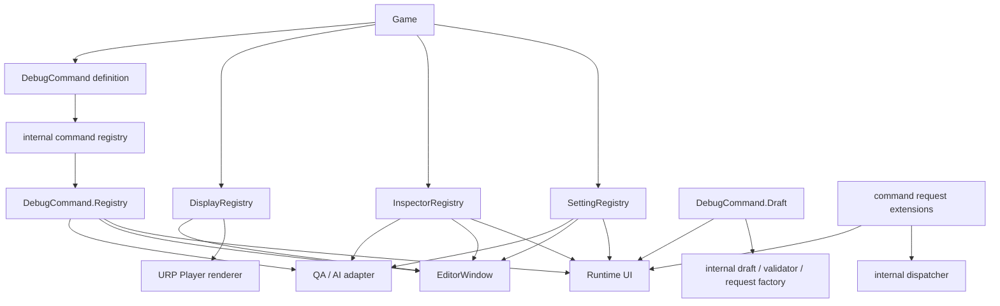

# DexcDebugger 機能設計

4機能の実装境界と、Runtime／Editor／外部adapterの接続方法を定める。

個別仕様は[DebugCommand](debug-command.md)、[DebugSetting](debug-setting.md)、[DebugInspector](debug-inspector.md)、[DebugDisplay](debug-display.md)を正本とする。画面構成は[Debug UIレイアウト・遷移仕様](debug-ui-layout.md)、範囲は[スコープ](core-scope.md)を参照する。

## 機能分類

| 機能 | ゲーム側が提供するもの | 利用者の主操作 | 主な結果 |
| --- | --- | --- | --- |
| DebugCommand | 一回の処理と入力 | 必要なら対象1件を選び、値を入力して実行 | 成否、出力、履歴 |
| DebugSetting | 継続的な環境設定 | 現在値を変更、reset、preset適用 | ゲーム環境への反映 |
| DebugInspector | 実行中instanceとmember | Sceneまたは登録一覧から選び、観測・変更 | 現在値、Watch、変更履歴 |
| DebugDisplay | HUD／Overlay／World表示data | 原則操作せず、Settingで表示を切り替える | 人間向け描画、AI向け構造化snapshot |

この4機能は同じUIに現れるが、定義、Registry、ライフタイムを共有しない。例えばFPS表示はDebugDisplayが値を受け取り、表示のON／OFFだけをDebugSettingが担う。

公開入口の責務は次のように分ける。

| 公開型 | 責務 |
| --- | --- |
| `DexcDebugger` | package全体の有効状態、初期化、Optionsを扱う |
| `DebugMenu` | Runtime Debug Menuの開閉、renderer選択、入力providerの設定を行う |
| `DebugBootMenu` | 起動メニューの開閉と開始を行う（[起動メニュー仕様](debug-boot.md)） |
| `DebugCommand`系基底class | 利用者がCommandを定義する継承契約を扱う |
| `DebugCommand.Registry` | Command定義一覧、descriptor、収集状態をreadする |
| `DebugCommand.Draft` | draft編集、validation、request生成を扱う |
| Command request拡張API | Dispatch、DispatchAsync、throw形式、非同期追跡を扱う |
| `DebugSetting` | Settingの公開操作を扱う |
| `DebugInspector` | instanceの登録・解除とInspectorの公開操作を扱う |
| `DebugDisplay` | HUD／Overlay／Worldへ表示dataを出力する |
| `DebugDiagnostics` | Collection／Operation diagnosticのsummaryと詳細をreadする |

`DexcDebugger`を4機能の総合Facadeにはしない。各機能のAPIを`DexcDebugger`から重複公開せず、`DexcDebugger.Open()`のような表示先が不明なAPIも設けない。

## 実装レイヤー



### Dexc.Runtime

UnityEngineへ依存する基本assemblyであり、次を所有する。

- 4機能の公開属性、基底契約、static入口
- runtime Reflectionによる定義収集
- descriptor、draft、result、history、diagnostic
- Unity object、scene、frame、game timeを含むライフタイム管理
- DebugDisplayのframe snapshot
- DebugDisplayのURP Player renderer（`DEXC_HAS_URP`のときだけcompileする）。World Visualは同じcompleted snapshotからPlayerの通常描画へ出力し、Gizmos／Handles／Editor callbackを使用しない
- 起動メニューの定義と値（`DebugBootSet`、`DebugBootSelection`）

4機能と起動メニューにUnity非依存のCoreは設けない。Unity非依存とするassemblyは、外部通信の枠とJSONを扱う`Dexc.Remote.Protocol`（`noEngineReferences`）だけとする。

### Dexc.DebugUI

Runtime Debug Menuの画面と入力制御、IMGUI／uGUI／UI Toolkitの各renderer、起動メニュー（`DebugBootMenu`、`DebugBootScene`）を所有する。既定rendererはIMGUIとし、RegistryのReflection情報を直接描画せず、各機能の公開read結果を描画して操作requestを返す。uGUI版とUI Toolkit版のrendererも同じ機能別APIへ接続する。

Runtime Debug Menuの公開入口はstatic classの`DebugMenu`とし、`Open()`、`Close()`、`Toggle()`を提供する。これらはRuntime Debug Menuの操作画面だけを開閉する。DebugDisplay rendererの有効性や表示中dataの寿命を変更しない。3関数は`void`かつ`ConditionalAttribute("DEXC_DEBUGGER")`の対象とし、Disabled状態では呼出しと引数評価を除去する。

Runtime UI本体は新Input SystemとLegacy Input Managerへ必須依存しない。pointer（mouse、touch）とtext入力は各rendererのUI event（IMGUI event、uGUIのEventSystem、UI Toolkitのpanel event）で受け取り、providerなしでtapやclickによりmenuを操作できる。gamepadとproject固有のgameplay input抑止は差し替え可能な入力providerへ委譲する。入力backendごとの標準providerは設けず、組み込みproviderは`Dexc.DebugUI`の`DebugGamepadInputProvider`だけとする。

Runtime navigation providerはfield編集用の`DebugInputEditor`から分離し、`DebugMenu.SetInputProvider`で登録と選択を同時に行う。active providerは最大1件とし、provider一覧、key、priority、auto selectionを設けない。別instanceの設定は現在のproviderを置換せず競合diagnosticとし、`ClearInputProvider`を経由した明示切替だけを許可する。sessionが無いとき、`SetInputProvider`と`ClearInputProvider`は何もしない。

`Dexc.DebugUI`はproviderをmain threadから1 frameにつき最大1回pollし、navigationのdead zone／repeat、submit／cancel、menu／text focus状態を管理する。providerはproject入力を共通frameへ変換し、`Closed`／`Navigation`／`TextInput`の通知に応じてgameplay inputを停止・復帰する。menu closeではproviderを保持するが、session再初期化では`Closed`を通知して登録を解除する。公開型と詳細な失敗規則は[Runtime入力との境界](debug-ui-layout.md#runtime入力との境界)を正本とする。

### Dexc.Editor

IMGUIによるEditorWindow（Dexc Debugger window、Dexc Boot window）、Unity選択同期、domain reload後の再接続、snapshot／diagnostic表示を所有する。Dexc.EditorはWorld VisualをScene Viewへ独自描画せず、Runtime Player rendererの代替またはcapture経路を持たない。Runtime UIとIMGUIの入力editorや状態表示primitiveを共有できるが、window lifecycleとlayoutは分離する。定義収集そのものはDexc.Runtimeと同じ経路を使う。

### 外部adapter

Transport、JSON-RPC、MCP、QA runnerは4機能の上に置く。Registry内部型をそのまま公開せず、各機能の一覧・読取・実行requestを外部schemaへ変換する。

process外からの操作は[DexcRemote仕様](remote-control.md)と[DexcRemote 運び手仕様](remote-transport.md)を正本とする。

## 4機能の状態

各機能の状態は機能ごとに分離してsessionに保持し、公開static入口から利用する。機能間で状態を共有しない。

| 機能 | 収集または登録 | 可変状態 |
| --- | --- | --- |
| Command | Command classとInputRef fieldをReflection収集、Source定義を参照 | descriptorとindexは収集後不変。draft、InputRef session handle、実行中request、result、historyは定義と分けて保持する |
| Setting | DebugSettingSetとPreset propertyをReflection収集 | Current、Preset catalog、変更履歴 |
| Inspector | field定義とSourceをReflection収集、instanceは手動登録も可能 | instance entry、Watch、変更履歴 |
| Display | static描画呼出しとSubjectから受信 | frame buffer、期限付きvisual、subject snapshot |

Reflectionによる定義の収集は機能ごとに初回利用時に1回行い、結果をcacheする。一覧取得のたびにassemblyを走査せず、明示Refresh APIも設けない。script compile後はUnityのassembly reloadとstatic resetを経て、次の利用時に再収集する。EditorとPlayerで収集経路を分けず、Editorの`TypeCache`やbuild時生成一覧を正本にしない。

Commandの公開入口は薄いprojectionであり、定義descriptorを保持する部分は実行主体にならない。

Reflection収集の入口となるAttributeは`PreserveAttribute`を継承し、`ConditionalAttribute("DEXC_DEBUGGER")`を付与する。symbol有効時はAttributeが示すtypeまたはmemberをmanaged strippingから保持する。symbol無効時はAttribute使用をmetadataへ出さず、DexcDebuggerからだけ到達する定義をstripping可能にする。

`DEXC_DEBUGGER`は利用projectがScripting Define Symbolsへ明示的に追加した場合だけ有効とする。packageはsymbolを自動追加せず、Editor、Development Build、Debug Buildを理由に暗黙有効化しない。Editorでもsymbol無効時はReflection対象を収集しない。

build targetごとの機能状態は次の3状態とする。

| Symbol | 状態 | 振る舞い |
| --- | --- | --- |
| `DEXC_DEBUGGER`のみ | Enabled | Reflection収集、登録、UI、操作を有効化する |
| どちらも未定義 | Disabled | Dexc assemblyと公開APIは存在するが、収集・登録・操作を行わない |
| `DISABLE_DEXC_DEBUGGER`を定義 | Assembly Excluded | `!DISABLE_DEXC_DEBUGGER`のDefine ConstraintsによりDexc assemblyをcompile・参照しない |

両symbolが定義された場合はAssembly Excludedとする。Disabled状態はdescriptor 0件と区別し、機能別read結果へ無効状態を明示する。Runtime UIとEditor UIは通常の空一覧を表示せず、機能が無効であることを表示する。

共通公開APIとして`DexcDebugger.IsEnabled`を設ける。`public static bool`のread-only propertyとし、`DEXC_DEBUGGER`定義時は`true`、どちらのsymbolも未定義なら`false`を返す。compile-time `const`にはせず、利用assemblyへ値を埋め込まない。状態参照は副作用、初期化、Reflection、Unity API呼出しを伴わない。

`DexcDebugger.IsInitialized`も`public static bool`のread-only propertyとして公開する。Enabledでも明示初期化前、再初期化開始後、初期化失敗後、DexcRoot更新後は`false`とし、session開始に成功してから次のresetまたは再初期化開始までは`true`とする。Disabledでは常に`false`を返す。`IsEnabled`と同様に副作用を持たない。

### 初期化と再初期化

package構成とruntime sessionの公開入口は`DexcDebugger.Initialize`とする。

public overloadは、package既定Optionsを使用する引数なし`Initialize()`と、`Action<DexcDebuggerOptions>`を受ける`Initialize(configure)`の2つとする。どちらも戻り値は`void`で`ConditionalAttribute("DEXC_DEBUGGER")`を持ち、Disabled call siteでは引数評価を含めて除去する。

`DexcDebuggerOptions`はFrameworkが既定値入りinstanceを生成してcallback中だけ渡す設定用classとし、public constructorを設けない。callback終了後に全値を検証してinternal immutable optionsへcopyする。`RuntimeUI.Skin`が指定された場合はasset参照を保持するのではなく、検証済みのlayout／style値と必要なUnity asset参照をsession snapshotへcopyする。利用者がcallbackからOptionsまたはSkin参照を保持して後から変更しても現在sessionへ影響しない。null callbackは`ArgumentNullException`とする。

暗黙初期化は行わない。Enabled時にsessionが無い状態で呼んだ公開APIは次のとおり動作する。

| API | sessionが無いときの動作 |
| --- | --- |
| `DebugCommand.Registry`、`DebugCommand.Draft` | `InvalidOperationException` |
| `DebugSetting`の全操作（`TryRead<T>`、`Write<T>`を含む） | `InvalidOperationException` |
| `DebugInspector`のread・操作（`Register`／`Unregister`を除く） | `InvalidOperationException` |
| `DebugInspector.Register`／`Unregister` | 何もしない |
| `DebugDiagnostics.GetSummaries` | 空pageを返す |
| `DebugDiagnostics.TryGetDetail` | `false`を返す |
| `DebugDisplay.TryGetCompletedFrame` | `false`を返す |
| `DebugDisplay`のDraw系と`Clear` | 何もしない |
| `DebugDisplay.CreateSubject` | no-op Subjectを返す |
| `DebugMenu.SetInputProvider`／`ClearInputProvider` | 何もしない。`null`引数は`ArgumentNullException` |

`DebugSettingSet<T>.Current`の直接read、`IsEnabled`、`IsInitialized`、未初期化案内を表示するRuntime Debug Menu shell、`DebugBootMenu`はsessionなしで利用できる。

利用projectは最初のDexc機能利用より前に明示的に`Initialize`する。既定Optionsを使用する場合も`Initialize()`を呼ぶ。package自身は`RuntimeInitializeOnLoadMethod`でsessionを自動初期化せず、project側が`BeforeSceneLoad`などの起動処理から`DexcDebugger.Initialize`を呼び出してsession初期化順序を管理する。非sessionのRuntime driver生成、render callback登録、UI state resetはpackage内部のroot bootstrapへ集約してよいが、これはsession generation、Reflection収集、登録、操作を開始しない。

Optionsは1つのsession中は不変とする。ただし`Initialize`の再呼出しは許可し、現在のsessionを破棄して新しいOptionsとsession generationで初期化し直す。設定値だけを途中変更するAPIにはしない。

再初期化はOptions callbackと検証より先に旧sessionを失効させ、`IsInitialized`を`false`にする。旧Options、Reflection descriptor cache、各機能のhandle、draft、request、result、history、diagnostic、Watch、Display buffer、期限付き表示、Subject、Command実行access gateを破棄する。旧generationのhandleとrequestはstaleになる。manual registrationとDisplay Subjectを含むゲーム側objectは、新session用に登録または生成し直す責任を持つ。

Options callbackが例外を送出した場合は同じ例外を呼出元へ返す。FrameworkのOptions検証に失敗した場合は`ArgumentException`を返す。どちらも旧sessionへrollbackせず、未初期化状態を維持する。新しいSession IDとGenerationはOptions検証成功後に確定する。

実行中の非同期CommandにはCancellationを要求するが、強制停止は保証しない。旧generationから遅れて完了した処理を新sessionのresult、history、diagnostic、実行access gateへ反映しない。ゲーム側で既に発生した副作用はrollbackしない。

DexcがCommand実行、Setting通知、Inspector accessor、Display providerなどの利用者codeを呼び出している途中から再帰的に`Initialize`することは禁止し、旧sessionを失効させる前に`InvalidOperationException`を返す。

DexcRootの更新（[Session identityとライフタイム](#session-identityとライフタイム)）で未初期化状態へresetし、project側が改めて`Initialize`する。

### Options

`DexcDebuggerOptions`は次のgroupをread-only propertyとして持ち、各group instanceのpublic setterでcallback中に値を指定する。

| Group | Member | 契約 |
| --- | --- | --- |
| Command | `DefaultAccess` | `DebugCommandAccess.Default`の実効access。package既定は`Lock` |
| History | `CapacityPerFeature` | Command、Setting、Inspectorそれぞれの履歴上限。0は保存なし |
| RuntimeUI | `Skin` | Runtime UI／Player DebugDisplay rendererが使用する`DexcRuntimeUISkin`。既定は`null` |

Diagnostic件数、Watch、Display、query pageの各上限は`internal`なgroup（`Diagnostic`、`Inspector`、`Display`、`Query`）が既定値で持ち、公開契約にしない。enumの未定義値を拒否し、不正値をclampまたは既定値へ補正しない。

`DexcRuntimeUISkin`は調整parameter用Settingsではなく、Windows／Android profileのlayout値、palette、font、Sprite／Texture／Material、Player World Visual ShaderなどのUI assetを束ねる唯一のScriptableObject契約とする。別の`DexcRuntimeUISettings` assetは設けない。`Skin == null`は許可し、Runtime UI shellはcode-only baselineで動作するが、専用ShaderなどSkin必須の描画は行わずsession diagnosticを1件記録する。Skinを指定した場合の不正な寸法、未定義enum、必須asset欠落はOptions検証失敗として`ArgumentException`にする。詳細は[Debug UIレイアウト](debug-ui-layout.md#runtime-ui-skinとasset包含)を正本とする。

Registry descriptor数にはOptions上限を設けない。Hierarchyの1 frame当たり探索量も公開Optionsへ含めない。

`DISABLE_DEXC_DEBUGGER`定義時はDexc assemblyとともに`DexcDebugger`型も存在しないため、`IsEnabled`でAssembly Excludedを判定することはできない。Assembly Excludedを選ぶ利用側codeは、自身もcompile symbolで分岐する。

戻り値が`void`の登録、通知、描画helperには`ConditionalAttribute("DEXC_DEBUGGER")`を使用し、Disabled状態では呼出しと引数評価をcompiled call siteから除く。戻り値を持つquery、実行request、Subject生成などには、assembly内の条件分岐で無効状態または副作用のないno-op objectを返す。無効状態でReflection走査、Unity Object探索、履歴作成、描画data生成を開始しない。

Assembly ExcludedではDexc型自体を参照できない。利用projectがこの方式を選ぶ場合、Dexc型を使用するgame側codeまたはasmdefも`DISABLE_DEXC_DEBUGGER`に応じて除外する。

Inspector SourceとCommandの`InputRef<T>`は、対象型、任意Key、候補entryを扱う内部Source catalogを共有する。共有するのは候補providerだけであり、CommandとInspectorのRegistry、履歴、UI、対象handleは統合しない。

## 機能別の公開read境界

UIと外部adapterは、各機能のFacadeが返す不変dataを読み取る。総合的なpublic `DebugBackend`、全機能共通の観測API、横断的な`DebugHistory`は設けない。Commandは`DebugCommand.Registry`／`Draft`、SettingとInspectorは各feature facade、diagnosticは`DebugDiagnostics`を入口とする。

公開readの対象は次とする。

- `DexcDebugger.IsEnabled`と一致する機能有効状態
- descriptor一覧、`DebugCollectionSummary`、除外定義、収集diagnostic
- 現在のdraft、validation、実行状態
- Settingの現在値とpreset差分
- Inspectorのinstance、component、field、Watch値
- Command／Setting／Inspectorのsession履歴
- DebugDisplayの完了frame snapshot

read結果はUIが保持してよい不変dataとし、Unity objectの強参照やReflection memberを画面層へ渡さない。対象やmemberはsession内handleで参照する。`Snapshot`という名称は、入力値、観測値、Displayの完了frameなど、取得時点の値をcopyして固定するdataだけに使用する。単なるdescriptor一覧やpageには使用しない。

共通の`DebugSnapshotResult<T>`、Token、Version、`Changed`／`Unchanged`／`Stale`、汎用delta protocolを公開しない。更新検出やcacheはUIまたは各機能のinternal実装に閉じ、公開APIを横断的なpolling protocolへ統合しない。

対象handleが失効したreadは、機能固有resultの`Stale`または`NotFound`で表し、同名、同Path、同instance IDの別対象へ自動的に結び直さない。再初期化時はUIが保持するIDとhandleを破棄する。

大きな情報は全体を一括取得せず、要求範囲を次の単位に制限する。

| 情報 | Read単位 |
| --- | --- |
| Command／Setting一覧 | 表示中Categoryまたは検索結果。件数が小さい場合は機能一覧全体も可 |
| Command詳細 | 選択中descriptor 1件 |
| Setting詳細 | 選択SetIdの項目。既存の有限pageで収集し、各descriptor／値を取得 |
| Scene Hierarchy | 展開したnodeのdirect children |
| Inspector | 選択中Source、instanceまたはComponent |
| Watch | 表示中Watch一覧の現在値 |
| History | 有限page |
| Diagnostic | Collection／Operationを分けた有限page |

検索結果、page size、1回のchildren件数にはOptions由来の上限を適用する。HistoryとDiagnosticもappend deltaや削除tombstoneを公開せず、要求時点のpageを返す。

AI／QA adapterへのread結果は要求単位で自己完結させ、以前のread結果の保持を必須にしない。queryとpageで範囲を制限し、Transportへ同期delta protocolを要求しない。

DebugDisplayはrendererが完了frame bufferを直接読む。

### Read API

公開readは同期APIとし、main thread限定とする。Runtimeは任意threadからのread、read用`ValueTask`、通信Cancellation、汎用main thread queueを提供しない。main thread外からの呼出しはサポートせず、検査もしない。

Runtime UIとEditor UIはmain threadから直接呼ぶ。Transport、AI、QA adapterは、network callbackなどを自身の責務でUnity main threadへ移してから同期read APIを呼ぶ。request admission、queue上限、timeout、通信Cancellation、送信処理はTransport側の責務とする。

各feature facadeは意味に応じて`GetList`、`TryGetDescriptor`、`GetHierarchyChildren`、`GetWatches`、`TryGetCompletedFrame`などの名前を使用する。正確なpayload型、失効時のstatus、同期形式は各機能仕様で定める。

### Page

有限一覧へ共通の`DebugPageRequest`と`DebugPageInfo`を使用する。

```csharp
public readonly struct DebugPageRequest
{
	public int Offset { get; }
	public int Count { get; }
}

public readonly struct DebugPageInfo
{
	public int Offset { get; }
	public int Count { get; }
	public bool HasMore { get; }
	public bool IsTotalCountKnown { get; }
	public int TotalCount { get; }
	public bool IsTruncated { get; }
}
```

`DebugPageRequest`のconstructorは`Offset`が0以上、`Count`が1以上であることを検証し、不正値には`ArgumentOutOfRangeException`を送出する。`Options.Query.MaxPageSize`は値型のconstructorで参照せず、各Facadeがrequestを受け付ける時点で検証し、超過には`ArgumentOutOfRangeException`を送出する。暗黙clampは行わない。Offsetが結果末尾を越えた場合はErrorではなく空pageを返す。途中検索など総数を安価に確定できない場合は`IsTotalCountKnown`をfalseとし、上限によって結果を打ち切った場合は`IsTruncated`をtrueとする。

### 階層一覧query

Command、Setting、Inspector SourceなどPath階層を持つ一覧は`DebugListQuery`を共通利用する。

```csharp
public readonly struct DebugListQuery
{
	public string PathPrefix { get; }
	public string SearchText { get; }
	public DebugPageRequest Page { get; }
}
```

PathPrefixとSearchTextはnullを禁止し、空文字列を未指定として扱う。PathPrefixはsegment境界で一致させ、`Enemy`を`Enemy/Damage`には一致させるが`EnemyBoss/Damage`には一致させない。SearchTextはPath、Display Name、Description、Tagsを`OrdinalIgnoreCase`で検索する。結果順はdescriptorのOrder、次にPathとし、利用者指定sort式は設けない。

### 機能別History query

履歴queryはCommand、Setting、Inspectorがそれぞれ定義し、履歴から行う操作に必要なIDと絞込みだけを持つ。3機能を混在させる`DebugHistoryQuery`と横断History APIは設けない。各履歴は新しい順、同一時刻では内部sequenceの降順とする。

### Diagnostic query

```csharp
public readonly struct DebugDiagnosticQuery
{
	public DebugDiagnosticSourceFilter Sources { get; }
	public DebugFeatureFilter Features { get; }
	public DebugDiagnosticSeverity? Severity { get; }
	public DebugPageRequest Page { get; }
}
```

Source filterはCollection、Operation、Allを表す。summary一覧は新しい順とし、詳細は`DebugDiagnostics.TryGetDetail(DebugDiagnosticId, out DebugDiagnosticDetail)`で1件取得する。未知のID、旧session／旧generationのID、operation ring bufferから削除済みのIDはいずれもfalseを返し、失敗理由を分けるresultは設けない。

### Hierarchy children query

```csharp
public readonly struct DebugHierarchyChildrenQuery
{
	public DebugSceneHandle Scene { get; }
	public DebugObjectHandle Parent { get; }
	public DebugPageRequest Page { get; }
}
```

Parentが無効値ならSceneのroot GameObject、指定されていればそのGameObjectのdirect childrenだけを現在のUnity Hierarchy順で返す。再帰的なdescendant取得は行わない。Scene unloadまたはParent消失はInspector固有resultの`Stale`とする。1回のCountは`MaxHierarchyChildren`と`MaxPageSize`の小さい方を越えられない。handleの正確な生成・失効規則はInspector仕様で定める。

Scene全検索は複数frameに分割し、検索状態へSearch ID、Searching／Completed／Cancelled、途中結果page、検査済み件数、総数確定状態、打切り状態を含める。結果は`MaxSearchResults`で打ち切り、field値を検索しない。検索開始・cancelのfeature固有APIはInspector仕様で定める。

大量log、screenshot、video、memory dump、長時間profiler data、完全なScene dumpを通常read結果へ含めない。

### 操作request

- Command draft作成、field更新、Ref候補取得・選択、実行、cancel
- Setting read、write、reset、preset一覧／preview／apply
- Inspector一覧展開、field読取、field書込み、Watch追加／解除
- diagnostic summary一覧取得、Diagnostic IDによる詳細取得

DebugDisplayは描画dataの出力機能であり、通常のUI操作requestを持たない。表示切替はDebugSettingを通す。

DebugDisplayはHUD／Overlay／Worldという表示UIを持つが、Display一覧やfilterを操作する専用Menuは持たない。Runtime Debug Menuが閉じていても、DebugSettingが有効で、表示dataの寿命が残っている限り描画を継続する。

## 共通descriptor規則

4機能で同じ基底classや汎用metadata containerは作らない。ただし次の値の意味は揃える。

| 値 | 規則 |
| --- | --- |
| Path | `/`区切り。一覧階層とsession内文字列指定を兼ねる |
| DisplayName | Pathの最終segment。明示上書きが必要な機能だけ追加可能 |
| Description | 影響、前提、危険性を人間とAIへ説明する |
| Order | 同じPath階層内の表示順。未指定時はPath順 |
| Tags | 検索補助。実行条件や権限を表さない |

Path重複は同一機能内で収集errorとする。異なる機能間では同じPathを許可する。

## Reflection収集

1. 対象assemblyを決定する。
2. 各Registryが自身の契約だけを探索する。
3. 型、member、属性、入出力型を検査する。
4. descriptorをimmutable dataへ変換する。
5. Path indexと型／member indexを作る。
6. 不正定義を除外し、diagnosticへ理由を残す。
7. 完成したcacheを一括で差し替える。

収集結果は、定義Errorが存在しても利用可能なdescriptorを含む有効なcacheとして確定する。1件の不正定義を理由にRegistryまたはDexcDebugger全体を初期化失敗へしない。backendは利用可能な項目と収集diagnosticを同時に返し、Runtime UIとEditor UIは正常項目を操作可能なままdiagnostic件数と詳細への導線を表示する。

無効化する範囲は、安全なdescriptorを作れない最小単位とする。

| 問題 | 無効化単位 |
| --- | --- |
| assemblyの型列挙失敗 | 取得不能だった型。取得済み型の検証は継続 |
| Command class、constructor、Input、Schema、Output契約の不正 | 該当Command全体 |
| SettingSetの型、constructor、Current／Default生成の不正 | 該当SettingSet全体 |
| Setting propertyの型、accessor、constraintの不正 | 該当Setting property |
| Preset propertyの型、getter、snapshot生成の不正 | 該当Preset |
| Inspector Source定義の不正 | 該当Source |
| DebugField定義の不正 | 該当field |
| Input editor provider定義の不正 | 該当provider |
| editor providerのPriority競合 | 該当descriptorとrendererのeditor選択。fieldは読み取り専用へfallback |
| 同一機能内のPath／Key重複 | 競合した全項目 |

重複時にReflection順や最初に見つかった項目を採用しない。壊れたInputだけをCommand formから除いて実行可能にするなど、公開契約を変える部分復旧も行わない。

一部assemblyの読込失敗で既存cacheを破棄しない。再収集中は直前のcacheを読取可能とし、完了時に世代番号を更新する。UIは世代変更を検知して選択中descriptorを再解決する。

managed strippingによってtypeまたはmember自体がReflection列挙から消えた場合は、無効項目としてdiagnostic化しない（runtimeに存在を知る情報がない）。入口Attributeによる保持を行うが、利用者定義Input、custom provider、他packageとの組合せまでlibraryだけで完全保持できるとは保証しない。この場合も検出できた別項目の利用は停止しない。

### 収集状態

公開する`DebugCollectionState`は次の3値に限定する。

| State | 意味 |
| --- | --- |
| `Disabled` | compile symbolにより機能が無効 |
| `Ready` | 利用可能なcacheが確定済み。除外定義やdiagnosticが存在しても`Ready` |
| `Unavailable` | 項目単位へ隔離できない内部不整合により、Registry全体として信頼できるcacheを構築できない |

`ReadyWithDiagnostics`は設けず、収集状態とdiagnosticの有無を分離する。一部assemblyや一部定義の失敗は原則として`Ready`である。`Unavailable`は完成cache自体を信頼できない場合にだけ使用し、他機能のRegistryを停止しない。

初回readはUnity main threadで同期収集を完了してから結果を返す。publicな`NotStarted`、`Collecting`、progress状態を設けない。明示Refresh APIも設けず、再収集は`DexcDebugger.Initialize`による新sessionまたはassembly reload後の初回利用で行う。

Command、Setting、Inspector、Input editor catalogの一覧結果は共通の`DebugCollectionSummary`を含む。DebugDisplayはReflection catalogを持たないため対象外とする。summaryは次を持つ。

- `DebugCollectionState`
- Session IDとCollection Generation
- 利用可能descriptor数
- 検出できた除外定義数
- Collection Error数とWarning数

descriptor本体と各機能の操作状態は機能別dataへ保持し、共通generic catalogへ統合しない。

### 除外定義

検出できた不正定義は有効descriptor一覧へ入れず、collection generation中有効な除外定義dataとして保持する。機能、取得できたPath／型名／member名、無効化単位、関連Diagnostic IDを持ち、Reflection objectを保持しない。

Path、型またはmemberによるlookup結果は次の3種類を区別する。

| 結果 | 扱い |
| --- | --- |
| 正常なdescriptorが存在する | 通常操作 |
| 収集時に検出したが除外した | 機能別resultで`definition-unavailable`とDiagnostic IDを返す |
| 収集時に存在を確認できない | `not-found`を返す |

共通の操作result型は追加せず、Command、Setting、Inspectorそれぞれのresultまたは受付結果で理由を表す。strippingによって列挙から消えた定義は`not-found`となる。

## Session identityとライフタイム

- descriptorは収集世代内で安定したIDを持つ。
- runtime instance、Command対象、Display Subjectにはsession内handleを発行する。
- handleはdomain reload、Play Mode終了、scene unload、instance unregisterで失効し得る。
- UIとadapterは操作直前にhandleの生存を再検査する。
- 永続IDへの変換は行わない。

libraryが持つmutable staticは`DexcRoot`だけとし、session、Registry、UI状態を含む実行中の状態はすべて`DexcRoot`から辿る。`DexcRoot`はSubsystem Registrationと、EditorのEdit Mode進入時に作り直す。Domain Reload無効時も前回Play sessionのinstance、draft、Watch、Subject、履歴を引き継がない。`DebugStorage.Factory`は状態ではなく構成として扱い、`DexcRoot`の作り直しをまたいで保持する。

## Main thread

libraryはUnity main threadからだけ呼ばれることを仕様とする。Reflection cacheの構築、Unity object列挙、Setting accessor、Inspector read／write、Commandの開始、Display bufferの交換、`Initialize`を含むすべての公開APIが対象である。別threadからの呼出しはサポートせず、runtimeで検査もしない。

外部adapterが別threadからrequestを受けた場合はadapter自身がmain threadへ処理を移して同期readを呼ぶ。Dexc.Runtimeは外部adapter向けのthread切替、request queue、通信Cancellation、送信処理を所有しない。

## 履歴

Command実行、Setting変更、Inspector書込みを共通History画面へ投影する。ただし各機能の元データは各Registryが所有する。

共通表示項目は時刻、機能、Path、対象label、結果、duration、公開errorとする。履歴はsession内の有限ring bufferであり、Command入力は`DebugValue` snapshotとして保存する。Setting、Inspector、Outputの値表現は各機能の契約に従う。共通のcaller情報を履歴へ保存しない。

DebugDisplayは通常履歴へ入れない。AI／QA向けには直近の完了frame snapshotを提供する。

## エラーとdiagnostic

エラー情報はValidation issue、Operation result、Diagnosticの3区分に分ける。4機能共通の汎用`Result<T>`へ統合しない。

### Validation issue

利用者が入力または選択を修正できる問題を表す。Command入力の範囲外、InputRef未選択、Setting値の不正、Inspector書込み値の不正、現在のゲーム状態によるUnavailableが該当する。共通の`DebugValidationIssue`はSeverity、Code、Messageだけを持つ。Commandだけが機能固有の`DebugCommandValidationIssue`で任意のCommand Field IDとIssueを関連付ける。SettingとInspectorは各resultがIssue一覧を持つ。共通Field IDや汎用Validation Targetは設けない。通常は例外を投げずUIの入力欄または操作button付近へ表示する。

### Operation result

Command実行は`CommandExecutionResult`で返す。Setting／Inspectorの操作は共通の`DebugResult`／`DebugResult<T>`で返し、`DebugOperationStatus`、validation issue一覧、Diagnostic IDと、成功時の値を持つ。Commandの成功、Failure、Cancelled、TimedOutは`DebugResult`へ含めない。staleなruntime object handle、lock競合、対象消失などの実行時状態も、C#例外ではなく該当機能のresultで返す。

### Diagnostic

利用者が入力を直しても解決しない定義または実装上の問題を表す。Reflection定義不正、constructor／Preset getter／`OnChanged`例外、Command未処理例外、Output projection失敗、Framework内部不整合が該当する。

公開resultには任意のDiagnostic IDだけを載せ、例外object、Reflection object、stack traceをUI read結果、履歴、外部schemaへ直接渡さない。詳細は有限のsession diagnostic storeへ保存し、Runtime UIとEditor UIはIDから取得する。外部adapterへ公開する範囲はTransport側で決める。

一覧用の`DebugDiagnosticSummary`と詳細用の`DebugDiagnosticDetail`を分ける。summaryはDiagnostic ID、Severity、Feature、Phase、Code、人間向けMessage、表示用identity、Collection GenerationまたはExecution ID、発生時刻を持つ。詳細はsummaryの情報に加えて例外型名、例外message、stack trace、inner exception情報を保持し、例外objectそのものはどちらにも含めない。

`DebugDiagnosticSeverity`は`Warning`と`Error`を持つ。Warningは項目を無効化しない注意、Errorは項目または機能を無効化した問題を表す。ValidationのSeverityとは別enumとする。

Collection diagnosticとoperation diagnosticは保存領域と削除規則を分ける。

- Collection diagnosticは該当collection generationが有効な間は削除しない。
- Operation diagnosticはOptionsで上限を持つ有限ring bufferとする。
- `Initialize`またはassembly reloadで旧generationのCollection diagnosticを破棄する。
- 旧sessionまたは旧generationのDiagnostic IDは詳細取得で見つからない（`TryGetDetail`が`false`を返す）。

### 共通公開型

4機能で共有するのは次の小さな情報型に限定する。

- `DebugValidationIssue`
- `DebugValidationSeverity`
- `DebugDiagnosticId`
- `DebugDiagnosticSeverity`
- `DebugDiagnosticSummary`
- `DebugDiagnosticDetail`
- `DebugCollectionState`
- `DebugCollectionSummary`
- `DebugSessionId`
- `DebugCollectionGeneration`
- `DebugPageRequest`
- `DebugPageInfo`
- `DebugListQuery`
- `DebugDiagnosticQuery`
- `DebugFeature`
- `DebugFeatureFilter`
- `DebugDiagnosticSourceFilter`
- `DebugHierarchyChildrenQuery`

各機能のresult、status、failure enumは共有しない。

`DebugValidationIssue`はSeverity、空でないCode、空でないMessageだけを持つimmutable classとする。機能固有fieldとの関連は各機能の型が保持する。

`DebugCollectionSummary`はCollection State、Session ID、Collection Generation、利用可能descriptor数、除外定義数、Collection Error数、Collection Warning数を持つimmutable classとする。共通Catalog、Descriptor基底型、Collection Resultは設けない。

各pageは`DebugPageInfo`と機能固有entryの`IReadOnlyList<T>`を持ち、返却後に内容が変化しないsnapshotとする。共通の`DebugPage<T>`やcollection interfaceは設けない。

### HandleとIDの共通規則

HandleとIDは機能ごとのstrongly typedな`readonly struct`とし、共通interfaceや基底型を設けない。public constructorを持たず、default値は無効とする。`IsValid`、equality、`GetHashCode`、diagnostic用`ToString`だけを公開し、数値変換、大小比較、永続化形式を公開しない。

default値など構造的に無効なHandleをAPIへ渡した場合は`ArgumentException`とする。以前は有効だったHandleがSession終了、Scene unload、Object破棄、登録解除によって失効した場合は、機能固有resultの`Stale`で表す。同名または同Pathの新しい対象へ自動再接続しない。

### 時刻とduration

履歴とDiagnosticが公開する絶対時刻はUTCの`DateTimeOffset`とし、property名は用途に応じて`OccurredAtUtc`、`ExecutedAtUtc`など`Utc` suffixを持つ。UIがlocal timeへ変換する。同一時刻の安定した並び順は公開時刻だけに依存せず、internal sequenceで決める。

処理時間、Command timeout、Inspector Watch intervalなどの経過時間は`TimeSpan`とする。DebugDisplayのRealtime／GameTimeは`DebugDisplayTimeScope`と秒数で表し、この共通時刻契約へ統合しない。

### Caller

共通の`DebugCaller`、`DebugOperationContext`、caller引数を公開しない。履歴にもcallerを保存しない。

### C#例外

C#例外はAPIの誤用に限定する。不正な引数、stale requestの再利用、validation失敗状態での`CreateRequest`、不正な初期化Optionsが該当する。ゲーム上の失敗、対象消失、実行access競合、timeout、Cancelは例外にしない。

capacity超過は各機能の有限容量規則に従い、古い履歴、Watch、Visualを破棄するか新規受付を拒否し、必要に応じてdiagnosticへ記録する。

## 性能規則

- Reflectionは収集時に限定し、frame更新で行わない。
- UI一覧はbounded readとvirtualizationを使用する。
- Scene Hierarchyは展開nodeだけを列挙する。
- Inspector WatchとDisplay Visualは件数上限と更新周期を持つ。
- Displayはwrite／read bufferを交換し、rendererとゲーム側の書込みを分離する。
- Debug機能無効buildではConditional入口またはno-op objectによりゲーム側分岐を最小化する。

## 設けないもの

- 4機能共通の汎用Registry
- 4機能共通の任意値dictionary
- 4機能のUnity非依存Core
- build時catalog、source generator、生成factory
- DebugDisplayを操作する独立メニュー
- 永続的な対象ID、履歴database
